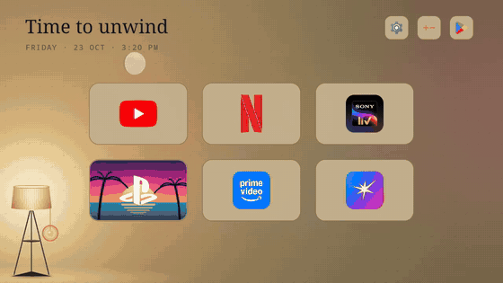
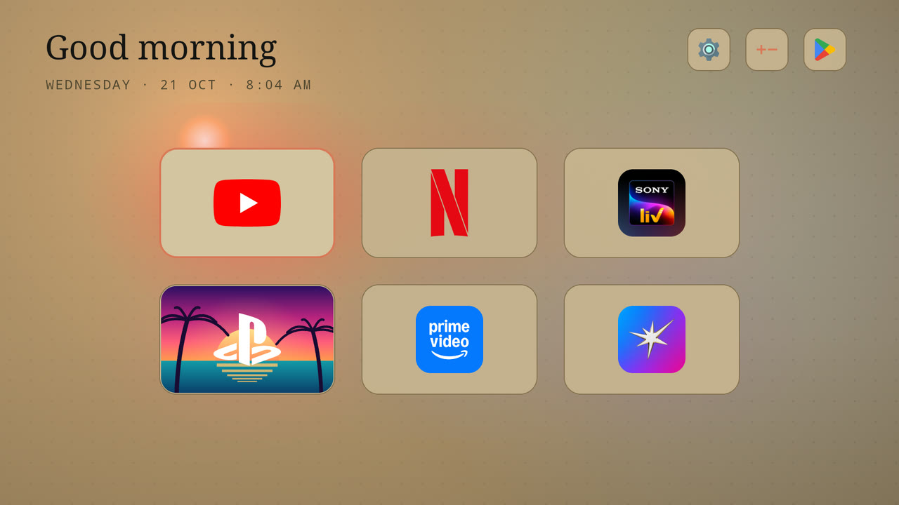
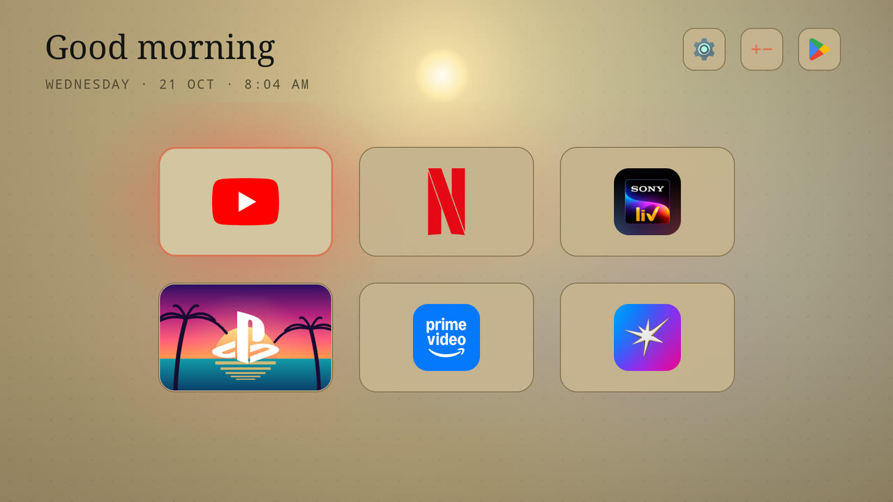
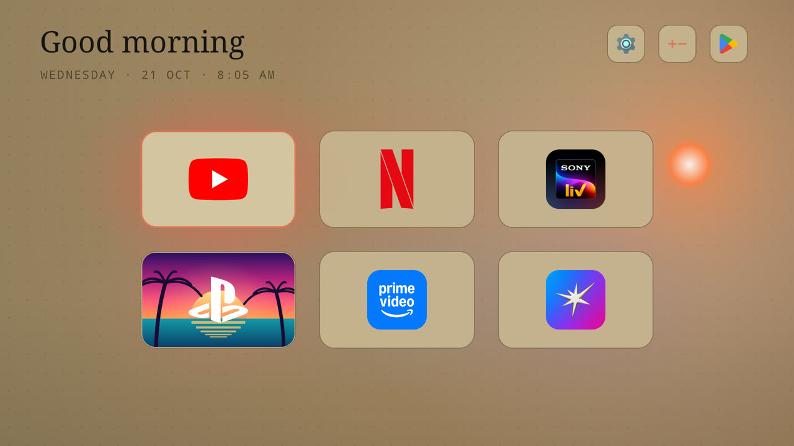
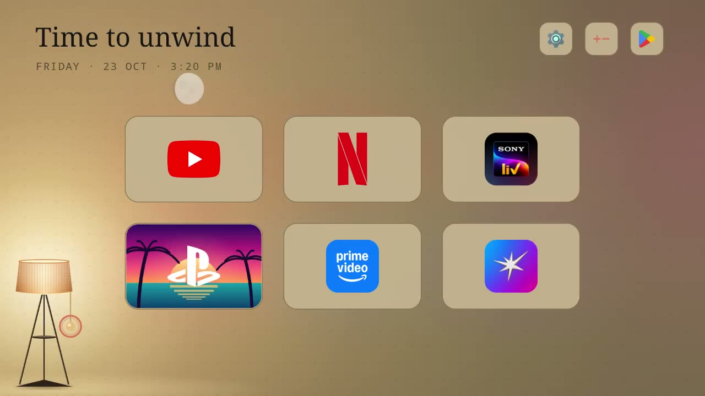

# Room Home

A calm, custom home screen for Android TV. Six big app tiles, a floor lamp, and a sky that follows the real sun and moon in India. When the lamp is on, a little spider drops down to switch it off.



Built for a Xiaomi Mi TV (MediaTek, 1.8 GB RAM, Android 14) and made to be light on memory, but it works as the home screen of any Android TV you can reach over Wi-Fi ADB.

## What it does

- **Six app tiles** in a 3 x 2 grid. Add or remove apps with the **+ / -** button; the grid scrolls when you add more.
- **Day and night.** From sunrise to sunset there is a sun on its arc across the sky, lighting the room, and the screen is always light. At sunset the **lamp fades in** and the **moon** (with today's real phase) takes over. At night you can pull the lamp's cord to switch between a warm light mode and a dim mode.
- **The lamp cord is the theme switch.** Select it with the remote and press OK. A spider rappels down on a silk thread, drops onto the cord, and its weight pulls it.
- **Something new every day.** The background colour mood, the faint pattern, and the spider's colour change each day. The greeting is random each time you return.
- **PS5 friendly.** Wake a PS5 and the TV turns on and jumps straight to it. Put the PS5 in rest mode and you land back on Room Home, without ever being pulled out of Netflix.
- **Home key always lands here**, even from apps that try to open the stock home screen.
- **Light on memory.** Roughly 22 to 41 MB, against about 100 MB for the stock Google TV home (two processes) on the same TV.

## Screenshots

| Morning | Noon | Evening |
|---|---|---|
|  |  |  |

| Night, lamp on | Night, dim |
|---|---|
|  |  |

(The clock in the screenshots shows the real time they were taken; the sky was set to other hours with the test switch described in `AGENTS.md`.)

## Use it with an AI assistant

Setting this up involves a few ADB commands. You can hand the whole job to any AI assistant that can run commands on your computer. Paste this:

> Set up Room Home on my Android TV. First read https://raw.githubusercontent.com/BansalAakash/room-home/main/AGENTS.md and follow it. Ask me for the TV's IP address when you need it.

Everything the assistant needs (prerequisites, exact commands, how to check each step worked, how to change the city or the apps, how to undo it) is in [`AGENTS.md`](AGENTS.md). There is also a short [`llms.txt`](llms.txt).

## Install yourself

1. On the TV: **Settings > Device Preferences > About**, tap **Build** seven times, then **Developer options** and turn on **USB debugging**. Note the TV's IP address (**Settings > Network**).
2. On your computer, install [Android platform-tools](https://developer.android.com/tools/releases/platform-tools) (for `adb`).
3. Download `room-home.apk` from the [Releases](../../releases) page, then:

   ```bash
   scripts/install.sh <tv-ip> room-home.apk
   ```

   Accept the "Allow USB debugging?" prompt on the TV the first time.
4. Press **Home** on the remote. You land on Room Home.

To go back to the stock home screen: `scripts/uninstall.sh <tv-ip>`.

## Make it yours

- **Your city's sunrise and sunset:** edit `LAT` and `LON` near the top of the sky code in `src/com/roomremote/launcher/MainActivity.java` (default is Bengaluru).
- **Your apps:** use the **+ / -** button on the TV, or change the default `APPS` list in `MainActivity.java`.
- **Your PS5 or console:** the HDMI input ids for the wake feature are constants at the top of `HomeWatcher.java`. See `AGENTS.md` for how to find yours.

## Build from source

You need a JDK and the Android SDK command-line tools (build-tools 34 and platform android-34). There is no Gradle:

```bash
./build.sh        # produces room-home.apk
```

## Credits and licence

MIT licensed. See [`CREDITS.md`](CREDITS.md): the spider is ported from a CodePen by webcrafters, and the app logos come from Simple Icons (their owners keep the trademarks).
